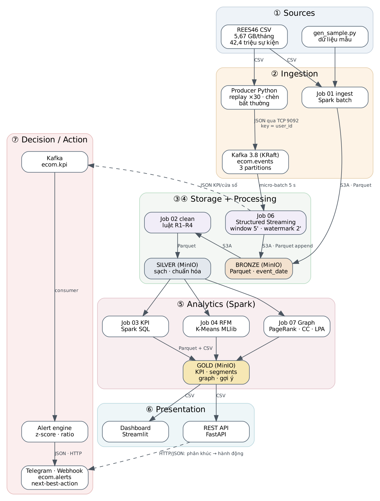

# ecom-lake — Hệ thống dữ liệu lớn phân tích hành vi khách hàng thương mại điện tử

Đồ án học phần **Nhập môn Dữ liệu lớn**, Khoa Công nghệ Thông tin, Trường Đại học Sài Gòn
Sinh viên: **Trần Chí Bảo**, MSSV 3123411029. Giảng viên hướng dẫn: **TS. Vũ Ngọc Thanh Sang**

Hệ thống đã chạy trọn trên **42.448.764 sự kiện thật** (view/cart/purchase, 5,67 GB CSV, REES46 tháng 10/2019) của một sàn thương mại điện tử. Có hai nhánh chạy song song:

- **Batch:** CSV đi qua Data Lake theo ba tầng bronze, silver, gold. Spark được dùng để làm sạch dữ liệu, tính KPI bằng Spark SQL, phân khúc khách hàng bằng RFM + K-Means và phân tích đồ thị sản phẩm mua cùng (PageRank, cộng đồng).
- **Streaming:** Producer đưa sự kiện vào Kafka. Spark Structured Streaming tính KPI theo cửa sổ thời gian. Một rule engine tự phát cảnh báo qua Telegram/Webhook.

Kết quả được phục vụ qua **dashboard Streamlit** và **REST API FastAPI**. API còn có endpoint gợi ý hành động cho từng khách hàng và gợi ý sản phẩm mua cùng.



## 1. Thành phần và công nghệ

| Giai đoạn pipeline | Thành phần | Công nghệ | Vì sao chọn |
|---|---|---|---|
| Sources | Dữ liệu REES46 hoặc `gen_sample.py` | CSV | Dữ liệu hành vi thật, quy mô hàng chục triệu bản ghi |
| Ingestion (stream) | `apps/producer.py` → topic `ecom.events` | Apache Kafka 3.8 (KRaft) | Bộ đệm bền, cho phép replay; partition theo user giữ thứ tự sự kiện |
| Ingestion (batch) | `jobs/01_ingest_bronze.py` | PySpark | Đọc song song file lớn, ép schema, ghi Parquet |
| Storage | Bucket `lake`: bronze / silver / gold | MinIO (S3 API) + Parquet | Object storage mở rộng ngang; Parquet lưu theo cột, nén tốt, hỗ trợ partition pruning |
| Processing | `02_clean_silver`, `06_streaming_kpi` | Spark 3.5.3 standalone (1 master + 2 worker), Structured Streaming | Xử lý phân tán; một engine dùng chung cho batch và stream |
| Analytics | `03_kpi_gold`, `04_segment_kmeans`, `07_product_graph` | Spark SQL, MLlib, GraphFrames | KPI, phân khúc khách hàng, đồ thị quan hệ sản phẩm |
| Presentation | `apps/dashboard.py`, `apps/api.py` | Streamlit, Plotly, FastAPI | Dashboard có bộ lọc; API có tài liệu Swagger |
| Decision / Action | `apps/alert_engine.py` + `conf/rules.json` | Python rule engine, Telegram Bot API, Webhook | Biến KPI thành cảnh báo và hành động tự động |
| Quan sát | Spark UI, History Server, Kafka UI, file CSV đo đạc | — | Thu thập bằng chứng hoạt động cho báo cáo |

## 2. Yêu cầu môi trường
- **Docker Desktop**, cấp tối thiểu **4 CPU, 10 GB RAM** trong Settings → Resources (máy thử nghiệm cấp 8 CPU logic, 10 GB RAM, swap 2 GB). Máy thử nghiệm: MacBook Pro 13" 2020, Core i5 4 lõi, 16 GB RAM.
- Còn trống khoảng **25 GB** ổ đĩa: 5,3 GB CSV, các tầng Parquet, Kafka và image Docker.
- `make`: trên macOS cài bằng `xcode-select --install`.

## 3. Chạy nhanh với dữ liệu mẫu (khoảng 15 phút, gồm cả thời gian build)
```bash
make up                         # build image + khởi động 10 container
make test                       # 8 kiểm thử Spark (làm sạch, RFM, đồ thị, PageRank)
make test-apps                  # 7 kiểm thử rule engine
make sample                     # 500.000 sự kiện mẫu có lỗi cố ý -> data/raw/sample/
make pipeline MIN_WEIGHT=1      # ingest -> clean -> gold -> segment -> graph
```
Mở dashboard tại <http://localhost:8501> và API tại <http://localhost:8000/docs>.

Demo streaming dùng **hai terminal**:
```bash
# terminal 1
make stream-reset
# terminal 2: sinh dữ liệu mẫu dày, phát lại nhanh 300 lần, chèn sự cố sập thanh toán từ giây 60 đến giây 120
make sample-stream
make produce SPEEDUP=300 ANOMALY=checkout_outage ANOMALY_START=60 ANOMALY_DURATION=60
make logs                       # xem cảnh báo của rule engine
```

## 4. Chạy với dữ liệu thật
1. Tải `2019-Oct.csv` từ Kaggle (*eCommerce behavior data from multi category store*, tác giả Michael Kechinov / REES46) rồi đặt vào `data/raw/kaggle/`.
2. Chạy batch:
   ```bash
   make reset                                  # xóa dữ liệu mẫu khỏi lake
   make ingest RAW="/data/raw/kaggle/*.csv"
   make clean && make gold && make segment K=4 && make graph MIN_WEIGHT=3
   ```
3. Xem `output/gold/segment_profile.csv`, đặt tên cho từng phân khúc trong `conf/segment_actions.json`.
4. Chạy streaming với dữ liệu thật (đúng lệnh đã dùng cho báo cáo):
   ```bash
   make stream-fresh            # cất kết quả cũ, tạo lại topic, xóa bronze_stream/checkpoint, restart rule engine
   make stream-reset            # terminal 1
   # terminal 2: phát lại 01/10/2019 từ 05:00 (bỏ 128.789 dòng đầu), tua x30, sập thanh toán 08:00–09:00
   make produce STREAM_RAW=/data/raw/kaggle/2019-Oct.csv SKIP=128789 LIMIT=606000 SPEEDUP=30 \
        ANOMALY=checkout_outage ANOMALY_START=360 ANOMALY_DURATION=120
   # S1 throughput tối đa:   make produce-max STREAM_RAW=/data/raw/kaggle/2019-Oct.csv SKIP=936253 LIMIT=300000
   # S4 chịu lỗi: giết job (docker compose exec spark-master pkill -9 -f 06_streaming_kpi.py),
   #              bật lại bằng make stream (không reset), rồi make bench FORMAT=bronze_stream CORES=2
   ```
5. Chạy thí nghiệm rồi vẽ biểu đồ: `make experiments` và `make charts`. Kết quả nằm ở `output/charts/*.png` và `output/charts/summary.md`.

Cảnh báo qua Telegram là **tùy chọn**. Tạo bot bằng @BotFather, rồi tạo file `.env` cạnh `docker-compose.yml` với nội dung sau, sau đó chạy `docker compose up -d alert-engine`:
```
TELEGRAM_BOT_TOKEN=123456:ABC...
TELEGRAM_CHAT_ID=987654321
```

## Kết quả trên dữ liệu thật (chi tiết trong báo cáo)
| Hạng mục | Kết quả |
|---|---|
| Làm sạch | 42.448.764 → 42.349.874 dòng (99,77%); job 02 mất 10,8 phút |
| Lưu trữ | CSV 5.669 MB → bronze 1.533 MB (27%) → silver 2.099 MB |
| Truy vấn | Parquet nhanh hơn CSV 5–17 lần; Q4 nhanh hơn 2,28 lần với 4 core |
| Phân khúc | k = 4, Silhouette 0,464; 10,4% khách VIP tạo 49,1% doanh thu |
| Đồ thị | 1.597 đỉnh, 5.646 cạnh; PageRank tự cài khớp GraphFrames (5,3×10⁻¹⁵) |
| Streaming | p95 7,9 s ở 555 sự kiện/s; tối đa khoảng 8.300 sự kiện/s (2 core); 0 mất / 0 trùng khi SIGKILL |

## 5. Giao diện web
| Địa chỉ | Thành phần |
|---|---|
| <http://localhost:8080> | Spark Master: các worker, ứng dụng đang chạy |
| <http://localhost:4040> / <http://localhost:4041> | Spark UI của job batch / job streaming đang chạy |
| <http://localhost:18080> | Spark History Server: xem lại job đã chạy xong |
| <http://localhost:9001> | MinIO Console: duyệt Data Lake (minioadmin / minioadmin123) |
| <http://localhost:8090> | Kafka UI: topic, partition, offset, consumer group |
| <http://localhost:8000/docs> | API Swagger |
| <http://localhost:8501> | Dashboard |

## 6. Kết quả sinh ra (`output/`)
| Đường dẫn | Nội dung |
|---|---|
| `quality/quality_report.json` | Vi phạm theo từng luật R1–R4, số dòng trước và sau làm sạch |
| `gold/*.csv` | Các bảng KPI, phân khúc khách hàng, gợi ý sản phẩm |
| `ml/k_search.csv`, `ml/final_model.csv` | Elbow + Silhouette khi chọn k |
| `graph/*` | Thống kê đồ thị, top PageRank, phân phối bậc, thành phần liên thông, cộng đồng |
| `streaming/producer_metrics.csv`, `producer_runs.jsonl` | Throughput ingestion |
| `streaming/latency.csv`, `progress.csv`, `kpi_windows.csv` | Độ trễ end-to-end, tốc độ xử lý, KPI theo cửa sổ |
| `alerts/alerts.jsonl`, `decisions.jsonl` | Cảnh báo đã kích hoạt và nhật ký mọi quyết định |
| `logs/runs.csv` | Thời gian từng bước của mọi job, kèm cấu hình cluster |
| `benchmarks/results.csv`, `storage.csv` | Kết quả thí nghiệm E1–E5 |
| `charts/*.png`, `charts/summary.md` | Biểu đồ và bảng số liệu tổng hợp cho báo cáo |

## 7. Cấu trúc mã nguồn
```
apps/            producer.py · alert_engine.py · rules.py · api.py · dashboard.py · make_charts.py · test_rules.py
conf/            spark-defaults.conf · rules.json · segment_actions.json
docker/          spark.Dockerfile · apps.Dockerfile · extract_graphframes.py
docs/            DATA_CONTRACT.md · KE_HOACH.md · VAN_DAP.md · VIDEO_DEMO.md · figures/
jobs/            common.py · transforms.py · 01..07_*.py
scripts/         gen_sample.py · lake_admin.py · run_experiments.sh · stream_fresh.sh · chup_minh_chung.py
tests/           conftest.py · test_clean.py · test_rfm_graph.py
```
Logic biến đổi dữ liệu nằm ở `jobs/transforms.py`, tách khỏi phần đọc/ghi để kiểm thử độc lập. Mỗi file job có docstring ở đầu giải thích mục đích và lựa chọn kỹ thuật.

## 8. Xử lý sự cố
| Hiện tượng | Cách xử lý |
|---|---|
| `pull access denied for minio/minio` | Image `minio/minio` đã bị gỡ khỏi Docker Hub (09/2026); dự án dùng `cgr.dev/chainguard/minio:latest` |
| Job đứng ở "Initial job has not accepted any resources" | Worker chưa đăng ký (máy ngủ làm worker mất heartbeat), hoặc job streaming đang chiếm core. Kiểm tra `curl localhost:8080/json/`; nếu 0 core thì `docker compose restart spark-worker-1 spark-worker-2`; giữ máy thức bằng `caffeinate -d` |
| Job 02 (clean) OutOfMemoryError trên dữ liệu thật | Đã sửa: không `persist`, bỏ cột metadata, `make clean` dùng task 64 MB và 200 partition shuffle |
| Executor bị kill (OOM, exit 137) | Tăng RAM cho Docker hoặc giảm `spark.executor.memory`; tắt `kafka-ui` để tiết kiệm RAM |
| Streaming báo lỗi offset sau khi xóa topic | Chạy `make stream-reset` |
| `ModuleNotFoundError: graphframes` | Job 07 tự chuyển sang PageRank BSP; kiểm tra log build của image Spark |

## 9. Sử dụng công cụ AI
Mã nguồn khung, tài liệu và bản nháp báo cáo được tạo với sự hỗ trợ của Claude (Anthropic). Sinh viên đã tự chạy toàn bộ hệ thống trên máy cá nhân, kiểm tra kết quả, chỉnh sửa và chịu trách nhiệm giải thích mọi phần. Chi tiết ghi ở phụ lục báo cáo.
